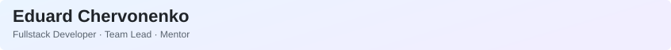

<picture>
  <source media="(prefers-color-scheme: dark)" srcset="https://raw.githubusercontent.com/ed-chervonenko/ed-chervonenko/main/banner-dark.svg?v=3">
  <source media="(prefers-color-scheme: light)" srcset="https://raw.githubusercontent.com/ed-chervonenko/ed-chervonenko/main/banner-light.svg?v=3">
  
</picture>

`TypeScript` `React` `Next.js` `NestJS` `PostgreSQL` `Docker`

[💼&nbsp;Portfolio&nbsp;↗](https://ed-chervonenko.github.io/) &nbsp; · &nbsp; [🎮&nbsp;PartySide&nbsp;↗](https://partyside.ru/) &nbsp; · &nbsp; [✈️&nbsp;Telegram&nbsp;↗](https://t.me/ra1n_xd)

Workstation

Ryzen 7 9800X3D · RTX 5080 · MacBook Pro M2 Pro

